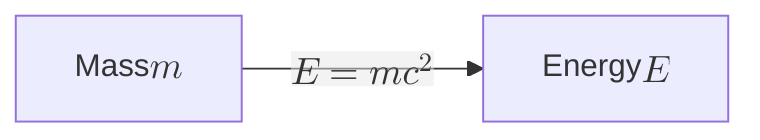

# Rendering

`@topik/content-react` displays Topik Markdown in a React application. It
validates the source, evaluates variables and conditions, and renders the
resulting reader tree. One document is enough: you do not need to compile a wiki
directory first. This page is for developers who embed Topik content in a React
application.

## Render with the default theme

```sh
npm install @topik/content-react react react-dom
```

Import the stylesheet once in the application's stylesheet entry point:

```ts
import "@topik/content-react/theme/styles.css";
```

`TopikContent` renders a source string with the built-in content components:

```tsx
import { TopikContent } from "@topik/content-react/theme";

export function Article() {
  return <TopikContent content={"# Getting started\n\nKeep a **backup**."} />;
}
```

### Supply your own component map

The root `@topik/content-react` entry point exports `renderTopikMarkdown` and
`renderTopikContent` for applications that own their component mapping. These
functions render a built-in tag with the component you pass for it. A tag
without a supplied component renders its children without the themed wrapper.
A video, which has no children, renders as a plain link with its poster, title
and caption.

In a client component, pass the complete themed map:

```tsx
"use client";

import { renderTopikMarkdown } from "@topik/content-react";
import { defaultTopikComponents } from "@topik/content-react/theme";

export function ArticleWithComponents() {
  return renderTopikMarkdown("# Getting started", {
    components: defaultTopikComponents,
  });
}
```

The `components` option changes React presentation only. `config.components`
governs content semantics and permitted properties, so a different renderer does
not make unsupported source valid.

### React Server Components

A server component can import `renderTopikMarkdown`, `renderTopikContent` and
`compileTopikContent`. The provider, the hooks, and the `theme` and `rich` entry
points are client modules, so a server component receives their exports as
opaque client references:

- It can render a component imported from those entry points.
- It cannot read properties of `defaultTopikComponents` or
  `getRichTopikComponents()`.

Assemble the map on the server from the components the content uses:

```tsx
import { renderTopikMarkdown } from "@topik/content-react";
import { TopikCallout, TopikCodeBlock, TopikLink } from "@topik/content-react/theme";

export function ServerArticle({ source }: { source: string }) {
  return renderTopikMarkdown(source, {
    components: { TopikCallout, TopikCodeBlock, TopikLink },
  });
}
```

### Color scheme

Pass `colorScheme="light"` or `colorScheme="dark"` to `TopikContent` or to
`TopikContentProvider` to choose the scheme for all content. An application with
a theme switch should pass the selected scheme, so that text, panels, figures
and rich output always agree.

With `colorScheme`, the content root carries a matching `data-theme` attribute:

- The stylesheet uses that scheme's colors.
- Figures show `src` or `darkSrc` to match.
- Rich components inside the root use the same scheme for code highlighting and
  diagrams, unless `RichTopikContentProvider` or `RichTopikThemeProvider` sets
  its own `theme`.
- A `colorScheme` on `TopikContent` takes precedence over one on the surrounding
  provider.
- An explicit `colorScheme` overrides a `.dark` class on an ancestor in both
  directions.

Without `colorScheme`, the root has no `data-theme`:

- The stylesheet uses dark colors only inside a `.dark` ancestor.
- Figures with `darkSrc` follow the reader's operating-system preference through
  `prefers-color-scheme`, because the renderer cannot observe the application's
  theme class. A figure can therefore disagree with the surrounding colors.

### Printing

The theme stylesheet includes print styles:

- Printed content uses the light colors and no canvas background, whatever the
  screen scheme.
- Copy buttons, wrap buttons and code fold toggles are hidden. Collapsed code
  lines are printed, and long code lines wrap.
- Tabs and code groups print their selected panel, so a reader's choice (for
  example a package manager) carries over to paper.
- Closed accordions print open in browsers that support `::details-content`;
  elsewhere they print as they are.
- Headings stay with the content after them. Callouts, cards, figures, videos,
  steps, questions and table rows avoid page breaks inside them.
- Videos print their poster and title with the source address instead of the
  player.
- With `rich/styles.css`, syntax-highlighted code prints as dark text and dark
  diagrams print with light diagram colors.
- Footnotes print at the end of the content without their back-links.

### Footnotes

A reference renders as `TopikFootnoteReference`, a superscript number linking to
its note. After the content, `TopikFootnotes` lists every shown note as a
`TopikFootnote`, in order of first reference, each with back-links to its
references.

| Component                | Props                                                         |
| ------------------------ | ------------------------------------------------------------- |
| `TopikFootnoteReference` | `number`, `id` (`fnref:1`, `fnref:1:2` …), `target` (`fn:1`)  |
| `TopikFootnotes`         | the notes as children                                         |
| `TopikFootnote`          | `number`, `id` (`fn:1`), `backrefs`, and the note as children |

The anchors are the same on every page, so two footnoted contents on one page
share them; give each its own component map with prefixed anchors if they must
coexist. Without themed components, footnotes still render as superscript links
and an ordered list, so a plain renderer keeps the notes.

### Video

The theme's `TopikVideo` plays `src` in a native `<video>` player named by the
video's `title`:

- A normal video has player controls and loads only its metadata until the
  reader starts it.
- A `loop` video is a silent clip. Once hydrated, it starts muted and looping
  and shows a Pause button instead of player controls. A reader who prefers
  reduced motion gets it paused, with a Play button. Server-rendered HTML keeps
  the native controls until hydration, so the clip stays playable without script.
- A compiled source is an MP4 or WebM file and always gets the player. Any other
  source gets the player only when its path ends in `.mp4`, `.m4v` or `.webm`.
  Anything else, such as a video page on a hosting service, renders as the poster
  and title as a link to `src`: it works without script and the reader's browser
  makes no request to the service until the reader follows it.
- When the browser cannot play a source it tried, the player is replaced by the
  same link.
- An unresolved source leaves the title, caption and poster as text.

Each prop is the evaluated attribute: `src`, `title`, `caption`, `poster` and
`loop`. A preview also passes `crossOrigin="anonymous"`, because the local
producer streams video only to CORS requests; pass it on to the `<video>`
element. A source that needs CORS is never rendered as a link, since navigating
to it cannot succeed.

An application that embeds a video service supplies its own component and
falls back to the theme's for other sources:

```tsx
"use client";

import { TopikContent, TopikVideo } from "@topik/content-react/theme";

// Your own URL check returns the embed URL, turning a `t=90s` timestamp into `?start=90`.
declare function youtubeEmbedUrl(url: string): string | undefined;

function Video(props: Parameters<typeof TopikVideo>[0]) {
  const embed = typeof props.src === "string" ? youtubeEmbedUrl(props.src) : undefined;
  if (embed === undefined) return <TopikVideo {...props} />;
  return <iframe src={embed} title={String(props.title)} allow="fullscreen; picture-in-picture" />;
}

export function Article({ source }: { source: string }) {
  return <TopikContent content={source} components={{ TopikVideo: Video }} />;
}
```

## Variables

Supply reader values through `config.variables`:

```tsx
import { TopikContent } from "@topik/content-react/theme";

export function Greeting() {
  return (
    <TopikContent
      content="Hello ."
      config={{ variables: { student: { name: "Ada" } } }}
    />
  );
}
```

The values are used in three places:

- A variable reference in body text inserts its value as literal text.
- Conditions select their branch from the same values.
- Supported `t"..."` component properties and paired ``
  examples insert the values. Ordinary quoted properties and unwrapped code are
  literal. The plain renderer, the rich code fallback, the syntax highlighter
  and the code copy control all receive the resolved code text.

Supply raw scalar values without HTML pre-escaping: server rendering escapes
text and properties as it does for any other content.

Format and store the authored source, not the rendered result, so that variable
references and every conditional branch survive. See
[Content format](./content-design.md#variables-and-conditions) for the
expression language and evaluation rules, and
[Text and code templates](./templates.md) for template locations and escaping.

## Handle invalid content

By default, `TopikContent`, `renderTopikMarkdown` and `renderTopikContent` throw
`InvalidTopikContentError` when the source cannot be admitted or evaluated. This
also applies during server rendering.

Request a placeholder when a reader should see a fallback:

```tsx
import { TopikContent } from "@topik/content-react/theme";

// Define the placeholder once: an inline function is a new component on every render.
function PreviewUnavailable() {
  return <p>This content cannot be previewed.</p>;
}

export function Preview({ source }: { source: string }) {
  return (
    <TopikContent
      content={source}
      invalidContent="placeholder"
      invalidContentPlaceholder={PreviewUnavailable}
    />
  );
}
```

The placeholder has alert semantics and does not expose the source or the
diagnostic text. Keep the source separately so that the author can correct it.

### Collect diagnostics

`TopikContent` reports problems through four optional callbacks: `onDiagnostic`
for compilation diagnostics, which are sanitized, and `onAssetDiagnostic`,
`onLinkDiagnostic` and `onNavigationDiagnostic` for asset, link and card
navigation references that the renderer omits. When they run depends on where
the content renders:

| Where                                          | When the callbacks run                       |
| ---------------------------------------------- | -------------------------------------------- |
| `TopikContent` in the browser                  | After the content commits, once per document |
| `TopikContent` during server rendering         | While rendering, because no commit follows   |
| `renderTopikMarkdown` and `renderTopikContent` | Synchronously, during the call               |

In the browser:

- A callback may update application state.
- Inline callbacks are safe. A new callback identity never causes recompilation,
  and the latest callback receives the report.
- Resolving the same document again, for example with a new `resolveLink`
  function, reports only when the resulting diagnostics differ.

When content cannot be admitted and no placeholder is requested, `onDiagnostic`
runs once for each diagnostic before `InvalidTopikContentError` is thrown. In
the browser, the nearest error boundary receives the error before the browser
paints. On the server, `onDiagnostic` runs during the render that throws.

### Keep interactive state across renders

`TopikContent` compiles again only when `content`, `file` or the value of
`config` changes. An inline `config` object with equal contents reuses the
compiled document.

New `onNavigateLink`, `renderLink`, `resolveLink` or `resolveAsset` functions,
and a new inline `components` object with the same component functions, update
the rendered content in place. Interactive state such as quiz answers, selected
tabs and expanded code regions is kept.

Define component functions once, outside render. A new component function is a
different component to React and remounts its content.

### Compile before rendering

To inspect a result before rendering, compile explicitly. This example passes the
complete themed map, so it is a client component:

```tsx
"use client";

import { compileTopikContent, renderTopikContent } from "@topik/content-react";
import { defaultTopikComponents } from "@topik/content-react/theme";

export function CheckedArticle({ source }: { source: string }) {
  const result = compileTopikContent(source);
  if (!result.ok) return <p role="alert">This content cannot be displayed.</p>;
  return renderTopikContent(result, { components: defaultTopikComponents });
}
```

The result has `ok` and the exact `source`. Success adds a reader `tree`;
failure adds diagnostics and has no tree. `@topik/content` exports the same
`compileTopikContent` function for consumers with another rendering framework.

## Rich code, math, and diagrams

`@topik/content-react/rich` adds Shiki syntax highlighting, KaTeX math, and
diagrams. Authors write a diagram as a `mermaid` fence in Mermaid syntax, and
Pele renders it. Install the optional peers that your content needs:

| Feature                | Peer dependency and supported range            |
| ---------------------- | ---------------------------------------------- |
| Code highlighting      | `shiki@^4.0.0`                                 |
| Math                   | `katex@^0.18.2` or `katex@^0.19.1`             |
| Mermaid syntax (Pele)  | `pele@1.13.0`                                  |
| Math in diagram labels | `pele@1.13.0` and either supported KaTeX range |

Wrap the themed renderer with the rich provider:

```tsx
import { RichTopikContentProvider } from "@topik/content-react/rich";
import { TopikContent } from "@topik/content-react/theme";

export function RichArticle({ source }: { source: string }) {
  return (
    <RichTopikContentProvider theme="light">
      <TopikContent content={source} />
    </RichTopikContentProvider>
  );
}
```

Import the rich stylesheet as well as the theme stylesheet. When using math,
include CSS and fonts from the same installed KaTeX version as its JavaScript:

```ts
import "@topik/content-react/theme/styles.css";
import "@topik/content-react/rich/styles.css";
import "katex/dist/katex.min.css";
```

Rich components load their peers in the browser. Server rendering emits the
fallback or loading state, and hydration completes the rich presentation:

| Content | While loading       | If rendering fails         |
| ------- | ------------------- | -------------------------- |
| Code    | Plain code          | Plain code                 |
| Math    | Plain fallback      | Plain fallback             |
| Diagram | A loading indicator | The diagram source as text |

### Diagrams

`TopikMermaid` and `RichTopikMermaid` render `mermaid` fences. Pele uses its own
layouts and CSS colors, so the output differs from Mermaid.js.

Loading and updates:

- Pele renders synchronously on the browser main thread after its lazy import.
- The loading indicator shows for at least 300 ms, even when the diagram is
  ready sooner.
- When the diagram source changes, the previous diagram stays visible, marked
  `aria-busy`, until the new one is ready.
- A theme change only recolors the existing diagram.
- Provider themes are isolated per diagram.

Use `accTitle` and `accDescr` to describe a diagram for assistive technology.
Each diagram gets unique accessible references for them.

Restrictions:

- Mermaid `themeVariables`, arbitrary HTML labels, plugins, and click callbacks
  are not supported.
- Topik disables all diagram links and images, including remote images, and
  validates the SVG before inserting it.
- Source is limited to 50,000 characters, flowcharts to 500 edges, and generated
  SVG to 4,000,000 characters.
- The application controls these limits. Author directives cannot change them or
  enable links or images.

Unsupported syntax and unrecognized SVG fall back to the plain diagram source.

### Math in diagram labels

Use `$$...$$` inside supported diagram labels for formulas:

````topik

````

Pele typesets labels in flowchart, swimlane, sequence, state, class, ER,
mindmap, kanban, block, requirement, and use case diagrams. Diagram titles and
class members stay as text.

Formulas in diagrams are native MathML, which Topik measures in the browser
before Pele lays out the diagram:

- KaTeX loads only when a diagram source contains `$$`.
- Diagram formulas use the browser's math font and do not require KaTeX's
  stylesheet. Standalone rich math does require the CSS above.
- MathML follows the diagram label colors in both provider themes.
- Pending page fonts may delay measurement by up to one second.
- Appearance varies with the browser and the installed math fonts.
- An SVG export that contains these formulas requires a browser that supports
  MathML inside `foreignObject`.

An expression stays as escaped TeX inside the rendered diagram when KaTeX is
missing, the TeX is invalid, the MathML is unsupported, measurements are
unavailable, or a limit below is exceeded.

| Limit                                 | Value     |
| ------------------------------------- | --------- |
| Expression resolutions per diagram    | 100       |
| Characters per expression             | 4,096     |
| Generated characters per expression   | 100,000   |
| Generated characters across a diagram | 1,000,000 |
| Measured width and height, each       | 4,096 px  |
| Macro expansions per expression       | 1,000     |
| Explicit size                         | 10 em     |

Typesetting runs with KaTeX trust disabled, strict errors, and fresh macros for
each expression. The SVG boundary accepts only Pele's fixed MathML wrapper and
passive presentation elements, so formulas cannot enable links, images, or HTML.

### Code highlighting and Content-Security-Policy

Rich code blocks use Shiki with the `github-light` and `github-dark` themes only,
so a bundler emits those two theme chunks. Every language that Shiki bundles is
available; each loads the first time a code block uses it.

Shiki's default Oniguruma engine runs as WebAssembly. With a
Content-Security-Policy, add `'wasm-unsafe-eval'` to `script-src`; otherwise
the browser refuses the engine and code blocks stay plain.

Hosts that cannot allow WebAssembly can select Shiki's JavaScript
regular-expression engine with `codeHighlightEngine`. That engine never loads
WebAssembly:

```tsx
import { RichTopikContentProvider } from "@topik/content-react/rich";
import { TopikContent } from "@topik/content-react/theme";

export function StrictArticle({ source }: { source: string }) {
  return (
    <RichTopikContentProvider codeHighlightEngine="javascript">
      <TopikContent content={source} />
    </RichTopikContentProvider>
  );
}
```

`RichTopikThemeProvider` accepts the same option for rich components rendered
without the provider. Nested providers inherit the engine unless they set their
own.

The JavaScript engine translates each grammar's Oniguruma patterns to native
regular expressions, and not every grammar translates identically. A code block
whose grammar fails under the JavaScript engine renders as plain code; it does
not fall back to WebAssembly or throw. Keep the default `"oniguruma"` when the
policy allows WebAssembly and exact Shiki output for every grammar matters.

## Integrate with application URLs

Compiled content identifies assets and other resources by name, not by URL. The
application supplies the URLs when it renders.

### Assets

Compiled content may contain generated `asset:` references. Supply `resolveAsset`
to map each generated name to a delivered URL; see [Assets](../resources/assets.md#render-compiled-assets).
A missing or malformed generated reference emits an asset diagnostic, and the
renderer omits the unresolved browser-facing URL.

A local preview host can also pass a `previewAssets` adapter, which loads
verified media from the local preview server. Create it with
`createPreviewAssetAdapter`, which two entry points export:

- `@topik/content-react/preview-assets` exports the function and its
  `PreviewAssetAdapter` and `PreviewAssetInventory` types without the Markdown
  compiler or the renderer.
- The root entry point exports the same function.

An adapter from either entry point works with the renderer. A single-page app
can therefore create the adapter in a store that its entry chunk loads and
import the renderer lazily, so the entry chunk stays small:

```ts
import { createPreviewAssetAdapter } from "@topik/content-react/preview-assets";
import type { PreviewAssetInventory } from "@topik/content-react/preview-assets";

export function createPreviewStore(origin: string, snapshot: PreviewAssetInventory) {
  return {
    previewAssets: createPreviewAssetAdapter({ origin, snapshot }),
    // The compiler and renderer load with the article view, not with the entry.
    loadRenderer: () => import("@topik/content-react"),
  };
}
```

### Resource links

A link to another page is a resource reference in compiled content:
`ref://wiki-page/<name>`, `ref://guide/<name>` or `ref://course-page/<name>`.
The name is the destination's exact `resource.name`, not its route slug. A query
and a heading fragment stay on the reference. Authors can also write this syntax
directly; see [Links between pages](../resources/navigation.md#links-between-pages).

Supply `resolveLink` to turn a reference into the application's browser URL. Use
the resource type and name as the lookup key, and keep the reference's query and
fragment:

```tsx
import { parseTopikResourceReference } from "@topik/content";
import { TopikContent } from "@topik/content-react/theme";

const routes = new Map([
  ["WikiPage/installation", "/docs/install"],
  ["Guide/getting-started", "/learn/start"],
  ["CoursePage/first-lesson", "/courses/basics/start"],
]);

function resolveLink(href: string): string | undefined {
  const reference = parseTopikResourceReference(href);
  if (!reference) return href;
  const route = routes.get(`${reference.type}/${reference.name}`);
  if (route === undefined) return undefined;
  return `${route}${reference.search}${reference.hash ? `#${reference.hash}` : ""}`;
}

export function PublishedArticle({ source }: { source: string }) {
  return (
    <TopikContent
      content={source}
      resolveLink={resolveLink}
      onLinkDiagnostic={(diagnostic) => console.warn(diagnostic.message)}
    />
  );
}
```

`resolveLink` receives every link destination and returns a browser URL or
`undefined`:

| Destination     | Return a URL                     | Return `undefined`               |
| --------------- | -------------------------------- | -------------------------------- |
| `ref://` target | The link uses it, if permitted.  | The link is unresolved.          |
| Ordinary URL    | The link uses the rewritten URL. | The link keeps its authored URL. |

Content without resource references does not need the hook.

A `ref://` link is unresolved when the hook is missing, throws, or returns
`undefined`, an unsafe URL, or another unresolved reference. The renderer then
omits the `href`, keeps the link text or card content visible, and emits a
diagnostic through the optional `onLinkDiagnostic` callback:

| ID                                    | Problem                                     |
| ------------------------------------- | ------------------------------------------- |
| `TOPIK_RESOURCE_REFERENCE_UNRESOLVED` | The reference did not resolve to a safe URL |
| `TOPIK_RESOURCE_REFERENCE_MALFORMED`  | A trusted tree holds a malformed reference  |

A link diagnostic contains a generic message and the `link.href` or `card.href`
slot. It never copies the destination or the resolver's exception.

Where to pass the hook:

- `TopikContent` and `TopikContentProvider` accept `resolveLink` as a prop.
- `renderTopikMarkdown`, `renderTopikContent` and `renderTrustedTopikTree` accept
  it in their options.

References resolve before custom components and `renderLink` adapters receive
their props, and server rendering emits the resolved URL. Modified clicks and
opening a link in a new tab therefore work. Two other hooks act after
resolution, and neither replaces `resolveLink` for a resource reference:

- `renderLink` selects the navigation component.
- `onNavigateLink` handles ordinary client navigation. Its `href` argument is
  the authored destination for an ordinary link and the resolved browser URL for
  a `ref://` link.

### Resolve links from route metadata

For wiki route metadata, use the shared
[Navigation helpers](../resources/navigation.md#resolve-navigation-in-an-application).

In Astro, `createTopikLinkResolver` builds the `resolveLink` hook from collection
entries and route callbacks that the application supplies. Astro loaders keep
the compiled references in each entry's body. Supply the `wikiPages`, `guides`
and `coursePages` catalogues with their corresponding `resolveWikiPage`,
`resolveGuide` and `resolveCoursePage` callbacks. Course entries can come from
any collection the application already has:

```ts
import { createTopikLinkResolver } from "@topik/astro";

const resolveLink = createTopikLinkResolver({
  coursePages: [{ id: "first-lesson", data: { slug: "start", course: "basics" } }],
  resolveCoursePage: (entry) => `/courses/${entry.data.course}/${entry.data.slug}`,
});

resolveLink("ref://course-page/first-lesson#exercise");
// /courses/basics/start#exercise
```

## Render a validated reader tree

`renderTrustedTopikTree` renders a reader tree that the caller has already
validated. The caller owns validation of the tree. The renderer checks only its
browser-facing asset and navigation fields. `TopikContent` accepts source
strings, not trusted trees.

## Migrate from Mermaid.js

Replace the optional `mermaid` installation with `pele@1.13.0`. Authored
`mermaid` fences and the public `TopikMermaid` and `RichTopikMermaid` components
need no change.

Expect these differences:

- Layouts and colors differ, because Pele uses its own.
- Mermaid `themeVariables`, arbitrary HTML labels, plugins, and click callbacks
  have no equivalent; see [Diagrams](#diagrams).
- The loading indicator has the same 300 ms minimum as before. The smaller
  renderer does not remove this visible delay.

## Migrate from content-schema

1. Replace `@topik/content-schema` imports with `@topik/content`.
2. Rewrite the configuration to use `components` and `variables`, with
   declarative attribute types such as `"string"` and `"boolean"`. The former
   Markdoc `tags`, `nodes`, `functions`, and `partials` configuration has no
   compatibility runtime.
3. Use `compileTopikContent` to get a reader tree for a React renderer. Parse
   results contain an mdast authoring tree with Topik nodes, which a renderer
   does not accept.
4. Recompile resources and asset inventories together after a content-format
   upgrade. Do not reuse old occurrence mappings with newly compiled documents.

A caller that already owns a validated reader tree can use
[`renderTrustedTopikTree`](#render-a-validated-reader-tree).
